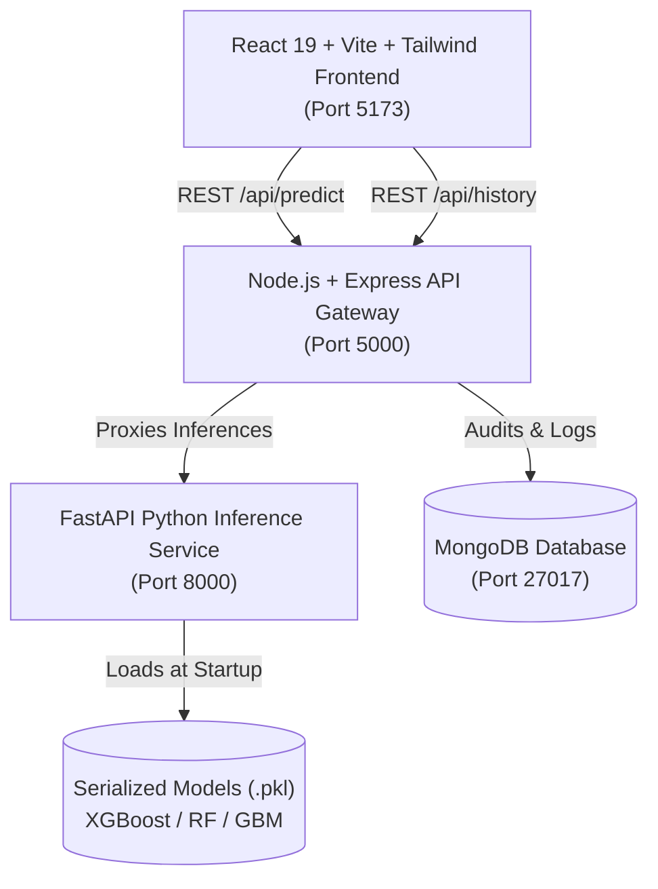

# 🏥 Medical Insurance Premium Prediction System
### *Production MERN + Python FastAPI Machine Learning Architecture with Explainable AI (SHAP)*

An enterprise-grade, end-to-end clinical machine learning actuarial platform that predicts annual medical health insurance premiums based on 10 clinical and biometric risk factors, powered by trained ensemble regressors (**Random Forest**, **XGBoost**, and **Gradient Boosting**) with **SHAP TreeExplainer** feature attribution.

---

## 🌟 Key Highlights & Architectural Features

- **Microservice ML Engine (Python + FastAPI)**: Pre-trained scikit-learn & XGBoost pipelines served with sub-15ms inference latency. Computes dynamic BMI feature engineering directly during request processing.
- **Explainable AI (SHAP TreeExplainer)**: Every prediction offers local Shapley waterfall and bar attribution charts showing exactly how each clinical condition (diabetes, surgeries, family cancer, transplants) impacted the baseline premium.
- **Enterprise API Gateway (Node.js + Express.js)**: Field-level schema validation via `express-validator`, Helmet security headers, CORS origin protection, audit logging, and resilient MongoDB storage with graceful offline fallback.
- **Modern Clinical SaaS UI (React 19 + Vite + Tailwind CSS v4)**:
  - Interactive patient biometrics form with real-time BMI calculator & category tagging.
  - Quick patient clinical presets (Young & Healthy, Middle-Age Diabetic, High-Risk Senior, Transplant Recipient).
  - Multi-model consensus comparison engine (run XGBoost vs Random Forest vs GBM concurrently).
  - Model Benchmarks dashboard with interactive Recharts for R², MAE, RMSE, and MAPE.
  - Auditable prediction history with search, filters, modal inspector, and CSV export.
  - Population risk analytics with demographic curves and prevalence distributions.

---

## 📊 Empirical Model Benchmark Results

Trained on 988 patient records with policy values in Indian Rupees (INR ₹):

| Model Algorithm | R² Variance Score | Mean Absolute Error (MAE) | Root Mean Squared Error (RMSE) | MAPE (%) | Key Characteristic |
| :--- | :---: | :---: | :---: | :---: | :--- |
| **XGBoost Regressor** | **83.79%** | ₹1,380 | ₹2,659 | 5.53% | Highest variance explained; regularized trees |
| **Random Forest Regressor** | **83.44%** | **₹1,295** | **₹2,688** | **5.29%** | Lowest absolute error; best generalizer |
| **Gradient Boosting (GBM)** | **81.21%** | ₹1,742 | ₹2,863 | 6.82% | Sequential gradient descent baseline |

---

## 🏛️ Application Architecture



---

## 📁 Repository Structure

```
Medical Insurance/
├── ml-service/                  # Python FastAPI Inference Engine
│   ├── app/
│   │   ├── main.py              # FastAPI endpoints & CORS
│   │   ├── predictor.py         # Model loading & prediction logic
│   │   ├── schemas.py           # Pydantic validation schemas
│   │   └── explainability.py   # SHAP TreeExplainer implementation
│   ├── models/                  # Serialized trained models (.pkl)
│   │   ├── xgboost_model.pkl
│   │   ├── rf_model.pkl
│   │   ├── gbm_model.pkl
│   │   ├── training_data.pkl    # Sample background for SHAP
│   │   └── metadata.json
│   ├── requirements.txt
│   └── train_and_save.py        # Reproducible training pipeline script
├── backend/                     # Express.js REST API Gateway
│   ├── config/db.js             # Mongoose connection with fallback
│   ├── controllers/             # Prediction, Model, & SHAP controllers
│   ├── middleware/              # Validation & error handlers
│   ├── models/Prediction.js     # Mongoose schema
│   ├── routes/                  # Express route definitions
│   ├── services/mlService.js    # Axios client proxying to FastAPI
│   └── server.js
├── frontend/                    # React 19 + Vite + Tailwind CSS UI
│   ├── src/
│   │   ├── components/          # Navbar, Footer, Form, ResultCard, SHAP
│   │   ├── pages/               # Predict, Compare, History, Analytics, About
│   │   ├── layouts/             # MainLayout with Toaster
│   │   ├── services/api.js      # Axios client
│   │   ├── utils/formatters.js  # Currency (INR), BMI & date formatters
│   │   └── index.css            # Tailwind design system styles
│   └── vite.config.js           # API reverse proxy configuration
├── run_services.bat             # 1-click Windows batch launcher
├── run_services.ps1             # 1-click PowerShell launcher
└── package.json                 # Unified npm orchestration
```

---

## 🚀 Quick Start Guide

### 1. Launch All Services (Recommended)

Simply double-click or run the included Windows script:

```powershell
.\run_services.bat
```
or via PowerShell:
```powershell
.\run_services.ps1
```

### 2. Manual Start (Three Terminals)

**Terminal 1 — Python ML Service (Port 8000)**:
```bash
cd ml-service
C:\Users\AMARNATH\anaconda3\python.exe -m uvicorn app.main:app --host 0.0.0.0 --port 8000 --reload
```

**Terminal 2 — Express.js API Gateway (Port 5000)**:
```bash
cd backend
npm run dev
```

**Terminal 3 — React Vite Frontend (Port 5173)**:
```bash
cd frontend
npm run dev
```

Open your browser at **[http://localhost:5173](http://localhost:5173)**.

---

## 📑 Feature Dictionary

| Attribute | Type | Description |
| :--- | :--- | :--- |
| `Age` | Integer (18–66) | Patient age in years |
| `Diabetes` | Binary (0 / 1) | Diagnosed diabetes mellitus |
| `BloodPressureProblems` | Binary (0 / 1) | Chronic hypertension or hypotension |
| `AnyTransplants` | Binary (0 / 1) | Major organ transplant recipient |
| `AnyChronicDiseases` | Binary (0 / 1) | Cardiovascular, pulmonary, or renal diseases |
| `Height` | Integer (145–188) | Patient stature in centimeters |
| `Weight` | Integer (51–132) | Patient weight in kilograms |
| `BMI` | Float (Engineered) | $Weight / (Height / 100)^2$ |
| `KnownAllergies` | Binary (0 / 1) | Environmental or medication allergies |
| `HistoryOfCancerInFamily` | Binary (0 / 1) | Immediate family history of cancer |
| `NumberOfMajorSurgeries` | Integer (0–3) | Major procedures with general anesthesia |

---

## 🛡️ License

MIT License. Designed and engineered for research, education, and actuarial decision support.
